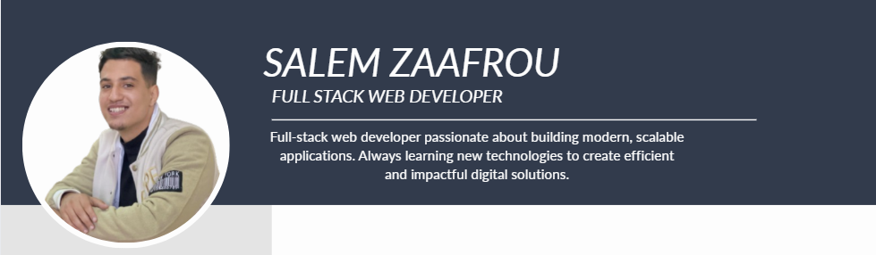

# Black & White GitHub Profile README

A premium, minimalist GitHub profile README for **Salem Zaafrou** inspired by modern developer portfolios. The design uses a clean black & white aesthetic with subtle animations, GitHub statistics, project highlights, and a recruiter-friendly layout.

> GitHub Username: **Salem-1822**

---

  

<h1 align="center">Salem Zaafrou</h1>

Full Stack Developer • React.js • Laravel • PHP • MySQL • MongoDB

---

# About Me

I'm a Full Stack Web Developer passionate about building clean, scalable and user-friendly web applications.

I enjoy transforming ideas into real-world products while continuously improving my skills in frontend and backend development.

Currently focusing on:

* React.js
* Laravel
* REST APIs
* MySQL & MongoDB
* UI / UX
* Software Architecture

---

# Tech Stack

---

# GitHub Analytics

---

# GitHub Streak

---

# GitHub Trophies

---

# Activity Graph

---

# Featured Projects

### HotelBooking

Modern Hotel Reservation Platform built with Laravel & Bootstrap.

**Features**

* Authentication
* Super Admin Dashboard
* Hotel Management
* City Management
* Reservation System
* Responsive Design

---

### Portfolio

Personal portfolio showcasing projects, technical skills and experience.

---

# Current Focus

* Clean Architecture
* REST APIs
* Laravel Best Practices
* React Performance
* Responsive UI
* Professional Software Design

---

# Connect With Me

---

---

*"First, solve the problem. Then, write the code."*

— John Johnson

